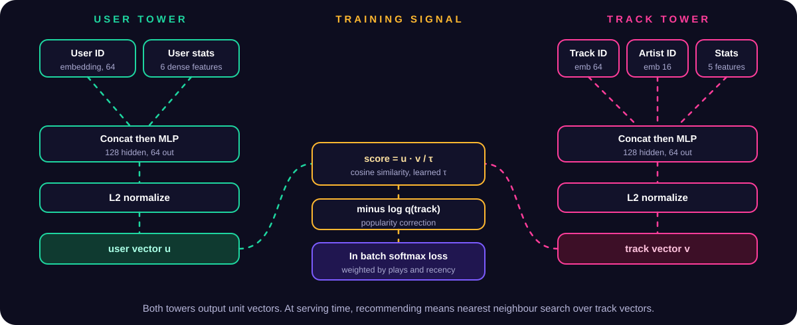

<div align="center">



<p>


</p>

**Learn what people listen to. Retrieve what they will love next.**

[Results](#-results) · [How it works](#-how-it-works) · [Quickstart](#-quickstart) · [Design choices](#-design-choices) · [FAQ](#-faq)

</div>


## 🎧 What is this?

A complete, reproducible recommender system built from raw listening logs. It learns one embedding for every user and one for every track, so that a user and a track they will enjoy land close together in the same vector space. That is the **two tower** design behind the candidate retrieval stage of most large scale recommenders.

Everything is here, from raw events to a metrics table: SQL aggregation, leakage free feature engineering, a PyTorch model, and an honest evaluation against a popularity baseline.



## 📊 Results



| Metric (test set) | Popularity | **Two Tower** | Change |
|---|---|---|---|
| NDCG@10 | 0.0650 | **0.1189** | **+83%** |
| Recall@20 | 0.0026 | **0.0063** | **2.4x** |

Each user's **newest 20% of tracks** are held out, so the model is tested on **discovery**: tracks the user had not heard yet. Every one of the 175,612 catalogue tracks is ranked for every user, and tracks the user already heard are excluded. No sampled negatives, no shortcuts.

> **Why is recall@20 so small?** Each test user has about 560 held out tracks, and recall divides hits by all of them. Even a perfect top 20 list would score only about 3.5%. The number to read is the ratio against popularity, which is scored the exact same way.

<details>
<summary><b>Training log from the reported run</b></summary>

<br/>

| Epoch | Val NDCG@10 | Val Recall@20 |
|---|---|---|
| 1 | 0.0727 | 0.0067 |
| 2 | 0.0836 | 0.0085 |
| **3** | **0.0891** | 0.0093 |
| 4 | 0.0880 | 0.0097 |
| 5 | 0.0843 | 0.0087 |
| 6 | 0.0804 | 0.0090 |

Early stopping (patience 3) kept the epoch 3 weights, chosen on validation. The test set was evaluated once, at the end. About 75 seconds per epoch on a laptop CPU.

</details>


## 🎛 How it works



**1. SQL.** 19.15M raw events stream into SQLite. A `GROUP BY` collapses them into 2.77M user and track pairs with play count, first listen and last listen. Tracks with fewer than 5 listeners and users with fewer than 20 tracks are filtered out in SQL.

**2. Features.** pandas builds 6 user features (history size, total plays, mean log plays, recency, history span, artist entropy) and 5 track features (listener reach, total plays, mean log plays, recency, track age). All statistics come from **training rows only**, so nothing leaks from the future.

**3. Split.** For every user, tracks are ordered by first listen time: oldest 70% train, next 10% validation, newest 20% test.

**4. Model.** Two towers, one scoring rule:



**5. Evaluation.** Full catalogue ranking with NDCG@10 and Recall@20, against a popularity baseline that ranks tracks by their number of training listeners.


## 🚀 Quickstart

```bash
git clone https://github.com/YugRokadia/music-recommender.git
cd music-recommender
pip install -r requirements.txt
```

**Try it in one minute, no download.** This generates a synthetic listening log and runs the whole pipeline:

```bash
python run.py
```

Synthetic numbers only prove the code runs. Use the real data for results.

**Run on the real Last.fm 1K dataset** (about 640 MB download, 2.5 GB unpacked):

<details open>
<summary><b>Windows (PowerShell)</b></summary>

```powershell
mkdir data -Force
cd data
curl.exe -L -o lastfm-dataset-1K.tar.gz "https://zenodo.org/records/6090214/files/lastfm-dataset-1K.tar.gz?download=1"
tar -xzf lastfm-dataset-1K.tar.gz
cd ..
python run.py --source lastfm --tsv "data/lastfm-dataset-1K/userid-timestamp-artid-artname-traid-traname.tsv" --epochs 10 --batch 4096
```

</details>

<details>
<summary><b>macOS / Linux</b></summary>

```bash
bash scripts/download_lastfm.sh
python run.py --source lastfm \
  --tsv data/lastfm-dataset-1K/userid-timestamp-artid-artname-traid-traname.tsv \
  --epochs 10 --batch 4096
```

</details>

Expect 5 to 15 minutes for loading and SQL aggregation before training starts. Results are written to `results.json`.

### Options

| Flag | Default | Meaning |
|---|---|---|
| `--epochs` | 15 | Maximum epochs (early stopping applies) |
| `--batch` | 2048 | Batch size, which is also the number of in batch negatives |
| `--dim` | 64 | Embedding size |
| `--lr` | 0.002 | Adam learning rate |
| `--patience` | 3 | Early stopping patience on validation NDCG@10 |
| `--min_track_users` | 5 | Drop tracks with fewer listeners |
| `--min_user_tracks` | 20 | Drop users with a shorter history |
| `--seed` | 0 | Random seed |

## 🧠 Design choices

| Choice | Why |
|---|---|
| **In batch sampled softmax** | Trains against thousands of negatives per step without scoring the whole catalogue |
| **logQ correction** | In batch negatives are popularity biased. Subtracting log q(track) removes that bias so the model does not just learn to push popular tracks |
| **Confidence weights** | Pairs are weighted by log play count and a recency decay, so loved and recent tracks teach the model more than one off plays |
| **Learned temperature** | The softmax sharpness is a trained parameter instead of a hand tuned constant |
| **Temporal split per user** | Random splits let the model peek at the future. Holding out each user's newest tracks mimics real deployment |
| **Train only statistics** | Every feature is computed from training rows, so evaluation is leakage free |
| **Full catalogue ranking** | Sampled evaluation can inflate metrics. This ranks all 175,612 tracks for every user |
| **Strong baseline** | Popularity is hard to beat on music data, so it is the honest comparison |

## 🗂 Project structure

```
music-recommender/
├── run.py                 entry point
├── src/
│   ├── data.py            events to SQLite, SQL aggregation and filtering
│   ├── features.py        pandas features, temporal split, sample weights
│   ├── model.py           two tower model and sampled softmax loss
│   ├── metrics.py         full catalogue NDCG@K and Recall@K
│   └── train.py           training loop, early stopping, baseline, evaluation
├── scripts/
│   └── download_lastfm.sh dataset download helper
└── assets/                README graphics
```

## ❓ FAQ

<details>
<summary><b>Why does the model start overfitting after epoch 3?</b></summary>

<br/>

The ID embeddings give the model a lot of capacity: 175K tracks times 64 dimensions, learned from about 2M training pairs. Validation NDCG peaks early and then falls, which is why early stopping on a validation split matters. Stronger regularisation, dropout on embeddings, or a lower learning rate are natural next experiments.

</details>

<details>
<summary><b>Why compare against popularity only?</b></summary>

<br/>

Popularity is the standard sanity baseline for music, and it is surprisingly strong. A model that cannot beat it has learned nothing about individual taste. Matrix factorisation (ALS or BPR) and item to item co occurrence are the obvious next baselines.

</details>

<details>
<summary><b>Is there track metadata like genre?</b></summary>

<br/>

Not in Last.fm 1K. The track tower uses the track ID, the artist ID and listening statistics derived from training data. Adding tags from the Last.fm API or using a richer dataset would be a clean extension.

</details>

<details>
<summary><b>How would this be served in production?</b></summary>

<br/>

Encode all tracks once, index the vectors in an approximate nearest neighbour index such as FAISS, and encode a user on demand to fetch the top candidates. A heavier ranking model would then re rank those candidates.

</details>

## 🛣 Roadmap

- [ ] Multiple seeds with confidence intervals
- [ ] Matrix factorisation and item to item baselines
- [ ] Sequence aware user tower (recent listening history as input)
- [ ] FAISS index and a small demo script for top K recommendations
- [ ] Tag and audio features for the track tower

## 🙏 Credits and data

Dataset: **Last.fm Dataset 1K users** by Òscar Celma (Music Technology Group, UPF), distributed with permission of Last.fm for **non commercial use**. When using it you must reference the Last.fm webpage. Hosted on [Zenodo](https://zenodo.org/record/6090214).

Sampled softmax with logQ correction follows Yi et al., *Sampling-Bias-Corrected Neural Modeling for Large Corpus Item Recommendations* (RecSys 2019).


<div align="center">

Built by [Yug Rokadia](https://github.com/YugRokadia). If this was useful, a star is appreciated. ⭐

</div>
